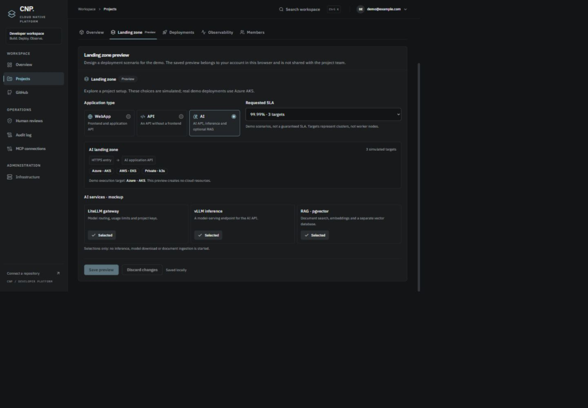

# Landing zones — maquette de démonstration

État du 9 novembre 2026. Les choix de landing zone, SLA et cibles sont une **maquette interactive**. Les démonstrations de déploiement réelles continuent sur Azure AKS, par le parcours CD existant. Cette fonctionnalité ne provisionne ni cloud, ni services IA, ni redondance multicloud.

## Parcours

1. Ouvrir **Projects → New project**.
2. Renseigner nom, slug et description. La création du projet dans CNP reste réelle.
3. Choisir un type d'application : **WebApp**, **API** ou **AI**. Le résumé de la landing zone change immédiatement.
4. Choisir le **Requested SLA**. Le catalogue de démonstration affiche les destinations correspondantes :

   | Objectif de démo | Cibles représentées |
   | --- | --- |
   | 99,5 % | Azure AKS |
   | 99,9 % | Azure AKS + AWS EKS |
   | 99,99 % | Azure AKS + AWS EKS + k3s privé |

   Les deux seuils supérieurs sont des scénarios de maquette, pas des engagements fournisseurs ou une politique de disponibilité qualifiée. Une cible représente un cluster CNP, pas une VM ou un pod. L'indicateur de SLA des plans de contrôle présent sur `main` reste indépendant.

5. Pour **AI**, ajouter ou retirer **LiteLLM gateway**, **vLLM inference** et **RAG · pgvector**. Les boutons représentent une sélection ; ils ne font pas tourner ces services.
6. Cliquer **Create project**. L'onglet **Landing zone · Preview** s'ouvre sur le projet créé.
7. Dans cet onglet, modifier les choix puis **Save preview** ou **Discard changes**. L'onglet peut aussi être ouvert sur un projet existant : `/projects/<id>?view=landing-zone`.

## Persistance et exécution

La maquette est enregistrée dans le stockage local du navigateur, avec une clé distincte par utilisateur et projet. Elle survit à un rechargement dans ce navigateur. Elle n'est pas synchronisée avec l'équipe, un autre navigateur ou un autre ordinateur. Effacer les données du site l'efface.

L'API de création reçoit toujours uniquement `name`, `slug` et `description`. Aucun champ de maquette n'est transmis à un job, un workflow ou une cible cloud. La configuration est enregistrée uniquement après la réussite de la création ; un échec de stockage affiche un avertissement sans recréer le projet. Les données locales invalides sont ignorées.

L'affichage « Demo execution target: Azure · AKS » décrit la cible retenue pour la démo. Il ne crée pas un `CloudTarget`, ne transforme pas une cible AWS existante en Azure et ne modifie pas les workflows. Pour exécuter réellement la démo, utiliser la cible Azure AKS du parcours CD existant. La maquette ne déclenche aucun déploiement.

## Références examinées sur GitHub

- [Documentation générale — architecture](https://github.com/Mindsept/Documentation/blob/main/cnp_docs/architecture.md) et [contrat Projects](https://github.com/Mindsept/Documentation/blob/main/cnp_docs/api/projects.md).
- [Architecture macro — landing zones](https://github.com/Mindsept/CNP----Architecture----Macro/blob/main/README.md#61-landing-zones) et [schéma structurel](https://github.com/Mindsept/CNP----Architecture----Macro/blob/main/landing-zones/cnp-landing-zones.svg), consultés sur `main` au commit `cb11a9b`.

Le schéma détaille **WebApp** : entrée HTTPS, Kong, frontend et API ; **IA** : API IA, LiteLLM activable, vLLM et RAG PostgreSQL/pgvector. La maquette **API seule** dérive de WebApp en retirant le frontend. Elle constitue le troisième profil demandé, pas une troisième zone déjà définie dans ce schéma. Les états d'avancement de la documentation ne constituent pas une preuve d'exécution de ces composants.

L'isolation, Keycloak, Vault, la livraison et l'observabilité sont des éléments du socle commun documenté. Kong et LiteLLM ont des fonctions différentes. La base du RAG, la base de gestion LiteLLM et la base CNP restent conceptuellement distinctes ; cette maquette n'en crée aucune.

## Vérifications

- Suite existante et nouveaux tests : 105 tests Vitest et 5 tests Node réussis.
- Tests de création avec les seuls champs API supportés, erreur API, stockage indisponible, trois scénarios, persistance, annulation, séparation utilisateur/projet et données locales invalides.
- TypeScript/Vite et lint ; les avertissements préexistants de lint et de taille du bundle restent à traiter séparément.
- Session CNP réelle : changement de scénario, trois boutons IA, sauvegarde, rechargement et annulation. Formulaire de création ouvert puis annulé, valeurs remises à zéro à la réouverture.
- Rendu contrôlé à 1440 et 390 pixels CSS ; pas de débordement horizontal mesuré dans la page et le dialogue mobile. Aucun message d'erreur JavaScript observé sur cette recette.
- La création effective via l'API est couverte avec un service simulé dans les tests ; aucun nouveau projet ni déploiement cloud n'a été créé pendant la vérification visuelle.

## Fichiers et intégration

- `src/lib/landing-zone-preview.ts` : catalogue et persistance locale validée.
- `src/components/projects/landing-zone-fields.tsx` : choix partagés entre création et onglet projet.
- `src/components/projects/project-landing-zone.tsx` : édition, sauvegarde et annulation de la maquette.
- `src/components/projects/create-project-dialog.tsx` et `src/pages/projects/project-detail.tsx` : intégration au parcours.

La branche `feat/landing-zone-preview` part de `feat/graphite-redesign`. Lors de son intégration à `main`, conserver les ajouts multicloud et le calcul de SLA existants : cette maquette ne remplace pas leur logique.
